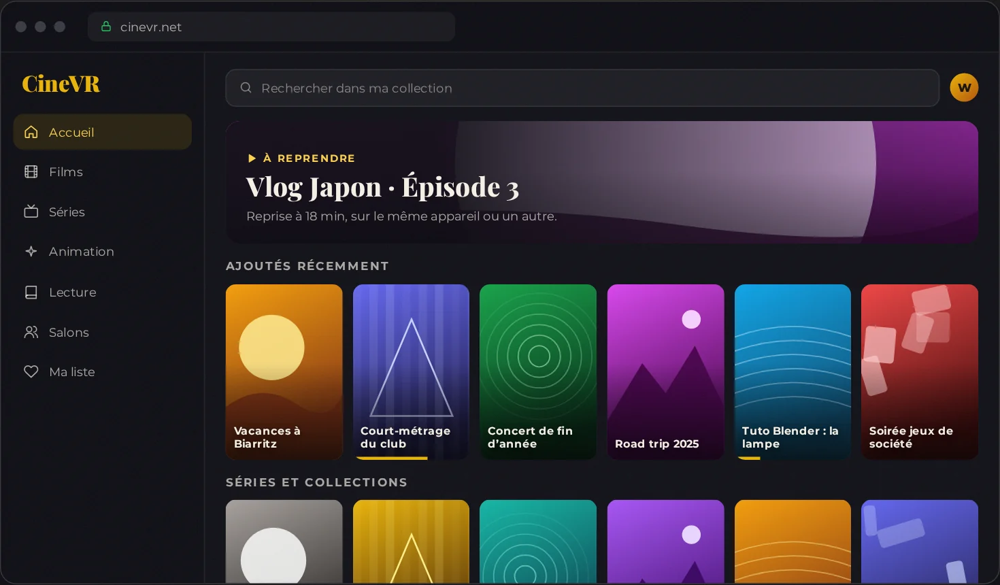
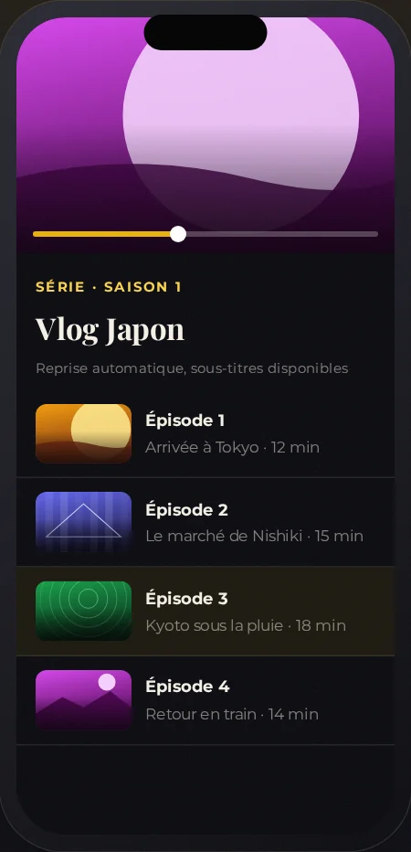
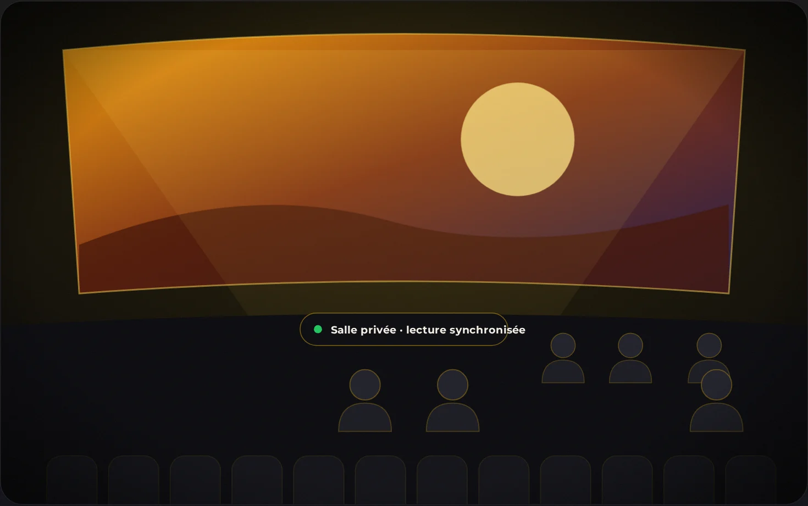
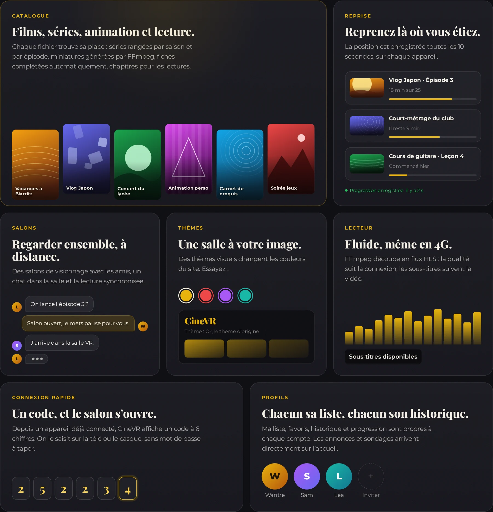
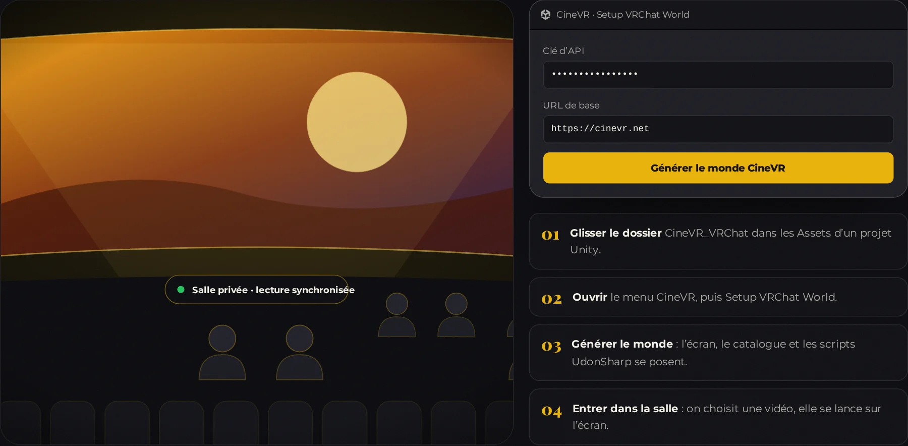
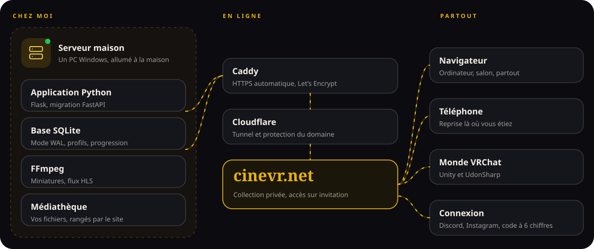
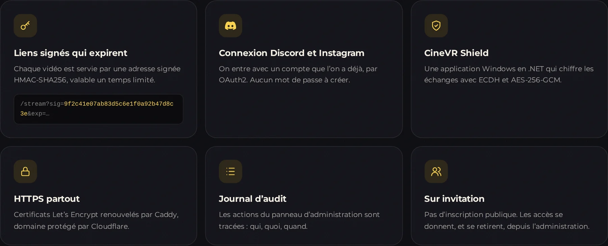

  

  &nbsp;&nbsp;
  

<b>CineVR</b> est une médiathèque personnelle hébergée sur un serveur à la maison. 
Elle range films, séries, animations et lectures, puis les ouvre dans le navigateur, sur le téléphone, et dans une salle de cinéma VRChat où l’on regarde ensemble.

Ce dépôt est une vitrine : le code de CineVR reste privé. L’accès au site se fait sur invitation.

---

## Trois écrans, une seule collection

Le même compte, la même liste et la même progression. On commence au salon, on continue dans le train, on finit dans la salle VR avec les amis.

<table>
  <tr>
    <td width="34%" align="center"></td>
    <td width="66%" align="center"></td>
  </tr>
  <tr>
    <td align="center">Sur téléphone</td>
    <td align="center">Dans le casque, salle VRChat</td>
  </tr>
</table>

Maquettes reconstituées d’après l’interface. Titres et visuels d’exemple.

## Ce que fait CineVR

| | |
|---|---|
| **Catalogue** | Films, séries rangées par saison et par épisode, animation et lecture en chapitres. Miniatures générées par FFmpeg, fiches complétées automatiquement. |
| **Reprise** | La position est enregistrée toutes les 10 secondes, sur chaque appareil. |
| **Salons** | Regarder ensemble à distance : salons de visionnage, amis, chat dans la salle, lecture synchronisée. |
| **Thèmes** | Des thèmes visuels changent les couleurs du site. |
| **Lecteur** | Flux HLS : la qualité suit la connexion, avec sous-titres. |
| **Connexion rapide** | Un code à 6 chiffres affiché sur un appareil déjà connecté ouvre la session sur la télé ou le casque. |
| **Profils** | Ma liste, favoris, historique et progression propres à chaque compte ; annonces et sondages sur l’accueil. |

## La salle VRChat

1. **Glisser le dossier** `CineVR_VRChat` dans les Assets d’un projet de monde VRChat (Unity).
2. **Ouvrir** le menu *CineVR → Setup VRChat World*.
3. **Générer le monde** : l’écran, le catalogue et les scripts UdonSharp se posent.
4. **Entrer dans la salle** : on choisit une vidéo, elle se lance sur l’écran pour tout le monde.

## Architecture

Pas d’hébergeur ni de stockage loué : un PC Windows à la maison fait tout tourner. Caddy chiffre en HTTPS avec Let’s Encrypt, Cloudflare protège le domaine par un tunnel.

## Accès privé

- **Liens signés** HMAC-SHA256 à durée limitée pour chaque lecture.
- **Connexion** Discord ou Instagram (OAuth2), ou code à 6 chiffres.
- **CineVR Shield**, application Windows en .NET : échanges chiffrés ECDH + AES-256-GCM.
- **Journal d’audit** des actions d’administration ; pas d’inscription publique.

## Technologies

  
  
  
  
  
  
  
  
   
  
  
  
  
  
  
  

---

  

  <a href="https://github.com/Wantre">
    <picture>
      <source media="(prefers-color-scheme: dark)" srcset="docs/wantre-lockup.svg">
      <source media="(prefers-color-scheme: light)" srcset="docs/wantre-lockup-black.svg">
      
    </picture>
  </a> 
  Fait par <a href="https://github.com/Wantre">Wantre</a>

Vitrine de présentation. Interface reconstituée, titres et visuels d’exemple ; aucune œuvre de tiers n’est montrée. Logos des technologies : Simple Icons, marques de leurs propriétaires. Tous droits réservés.

